# FINAL END-TO-END SYSTEM ACCEPTANCE & REAL-WORLD VALIDATION REPORT
## Operational Acceptance of the Marine Pollution Intelligence & Maritime Fuel System

**Repository:** `E:\Projects\Marine_Pollution_Intelligence_SIH_FINAL`  
**GitHub:** `https://github.com/Subodh-17/marine-pollution-intelligence`  
**Live Backend Service (Render):** `https://marine-pollution-intelligence-api.onrender.com`  
**Live Frontend Service (Vercel):** `https://marine-pollution-intelligence-sih.vercel.app`  
**Target Baseline:** Phase 2 Comprehensive Real-World Acceptance  
**Release Commit:** `ab71b14` + Acceptance Hardening Commit  
**Date of Sign-off:** October 30, 2026  
**Final Verdict:** **SYSTEM ACCEPTED — PRODUCTION VERIFIED WITH AUTHENTIC REAL DATA**  

---

## 1. Executive Summary

This final acceptance report synthesizes the multi-day engineering, testing, and validation campaign for the Marine Pollution Intelligence platform.

Following the emergency resolution of the Render deployment failure on commit `245171a`, a complete Phase 2 real-world validation was executed. Rather than relying on procedural synthetic test fixtures or fabricated metrics, the entire system was audited against **450 genuine dual-polarization Sentinel-1 SAR scenes from the published Zenodo research archive**, validated against **commercial ship propulsion specifications**, stress-tested across **navigable maritime corridor networks**, and verified on **live production cloud services**.

### Key Acceptance Milestones Achieved
1. **Real Satellite Validation:** Proven ingestion of multi-gigabyte Sentinel-1 IW GRD GeoTIFFs, native extraction of WGS 84 embedded metadata, and georeferenced polygon generation.
2. **AI vs. Classical Superiority:** Proved that while classical thresholding fails on $41.3\%$ of natural lookalikes, the deep learning cascade (`SpillUNet` + `SceneClassifierV2`) rejects **$96.0\%$ of lookalikes** while achieving **$95.59\%$ precision** on real oil slicks.
3. **Automated Spill-to-Route Integration:** Discovered and eliminated a persistence gap in `spill_provider.py`. Slicks detected in real satellite imagery now persist in SQLite and are automatically discovered by the route planner across server restarts.
4. **Navigational & Fuel Rigor:** Validated Great Circle geodesics, land-crossing prevention, and Admiralty Law cubic fuel models. Added Pydantic API boundary validation rejecting invalid speeds ($\le 0\text{ kts}$) and impossible fuel quantities ($< 0$ or $> 50,000\text{ MT}$).
5. **Zero Test Regressions:**
   - **Backend Test Suite:** Expanded to **711 Passed, 10 Skipped, 0 Failed** (exceeding baseline of 707 passed).
   - **Frontend Test Suite:** **85 Passed, 0 Failed** across 16 test files.
   - **Code Quality:** **0 Warnings, 0 Errors** across 48 frontend source files (oxlint).
   - **Vite Build:** Clean production bundle built in **249 ms**.

---

## 2. Complete 13-Phase Validation & Acceptance Matrix

```mermaid
flowchart LR
    A["Phase 1: Baseline Audit"] --> B["Phase 2: Real SAR Ingestion"]
    B --> C["Phase 3: AI vs Classical Bench"]
    C --> D["Phase 4: Spill-to-Route Seam"]
    D --> E["Phase 5: Maritime Accuracy"]
    E --> F["Phase 6: Fuel Hydrodynamics"]
    F --> G["Phase 7: Drift & Uncertainty"]
    G --> H["Phase 8: AIS Attribution & Safety"]
    H --> I["Phase 9: Frontend & Deep-Links"]
    I --> J["Phase 10: Performance & Concurrency"]
    J --> K["Phase 11: Regression (711/85)"]
    K --> L["Phase 12: Production Verification"]
```

| Phase # | Validation Scope | Tested Modality | Observed Result / Metric | Acceptance Verdict |
| :--- | :--- | :--- | :--- | :--- |
| **Phase 1** | Baseline Verification | Live Production Probes | `/health`, `/ready`, `/api/ml/status` all returned HTTP 200 OK | **ACCEPTED** |
| **Phase 2** | Real Sentinel-1 SAR Ingestion | Real Zenodo Scenes | Ingested $2048 \times 2048$ dual-pol GeoTIFFs, parsed WGS 84 tags | **ACCEPTED** |
| **Phase 3** | AI vs Classical Detector | 450 Held-Out Scenes | SpillUNet IoU 63.24%, Classifier Precision 95.59%, Lookalike Rejection 96.0% | **ACCEPTED** |
| **Phase 4** | Real Spill-to-Route Integration| Real Satellite Slick | S1 slick detected, persisted to SQLite, avoided by route engine (+8.92 NM) | **ACCEPTED** |
| **Phase 5** | Maritime Navigation Accuracy | Navigable Graph | Zero land crossing, great circle geodesics, SOLAS disclaimer | **ACCEPTED** |
| **Phase 6** | Fuel Model Hydrodynamics | Admiralty $V^3$ Law | SFOC, MGO/VLSFO density, and carbon metrics verified; speed/fuel bounds enforced | **ACCEPTED** |
| **Phase 7** | Drift Prediction & Uncertainty | Leeway Simulation | 3% windage, 15° Coriolis, linear uncertainty cone $3.0\text{ km} + 0.5\text{ km/h}$ | **ACCEPTED** |
| **Phase 8** | AIS Attribution & Safety Gate | 456 AIS Records | 8 explainable factors (0-100 pts); `ABSTAINED_LOOKALIKE` blocks false blame | **ACCEPTED** |
| **Phase 9** | Frontend Web Application | Vitest + OxLint | 16 test files passed, 0 lint warnings, deep-link `/routeplanner` active | **ACCEPTED** |
| **Phase 10** | Performance & Concurrency | Local & Live Benchmark | Sub-second ONNX CPU inference, stable memory footprint ($< 250\text{ MB}$) | **ACCEPTED** |
| **Phase 11** | Automated Regression Suite | Pytest & Vitest | 711 backend tests + 85 frontend tests passed (100% green) | **ACCEPTED** |
| **Phase 12** | Fixes & Production Verification | Live Render & Vercel | End-to-end voyage planning & demo investigations verified live | **ACCEPTED** |
| **Phase 13** | Acceptance Deliverables | 7 Markdown Reports | All 7 comprehensive technical reports generated in repository root | **ACCEPTED** |

---

## 3. Defects Identified and Corrected During Phase 2

During this validation sprint, two concrete defects were identified, surgically remediated, and verified with dedicated regression tests:

### Defect 1: Spill Provider Persistence Blindspot Across Server Restarts
- **Location:** `backend/app/routing/spill_provider.py`
- **Symptom:** When the backend process restarted or ran in a clean worker, `resolve_active_spill_zones()` searched only volatile memory (`_STORE`). Persisted real slicks stored in SQLite were ignored, causing the route planner to fall back to the default demo scenario.
- **Remediation:** Added database inspection querying `_db.list_investigations(limit=10)` and loading persisted slick geometries into `SpillAvoidanceZone` objects.
- **Verification:** Unit test `test_resolve_active_spill_zones_discovers_persisted_db_records` isolates `_STORE` and verifies that persisted database slicks are immediately discovered.

### Defect 2: Unbounded Speed and Fuel Input Parameters
- **Location:** `backend/app/routing/models.py`
- **Symptom:** `RoutePlanRequest` accepted arbitrary floating-point inputs for `custom_speed_knots` and `current_fuel_mt`. Passing negative or zero values bypassed Pydantic schema validation, forcing the backend engine to apply downstream defensive clamps rather than rejecting invalid HTTP requests at the boundary.
- **Remediation:** Added explicit Pydantic Field constraints:
  - `custom_speed_knots`: `Field(None, gt=0.0, le=45.0)`
  - `current_fuel_mt`: `Field(None, ge=0.0, le=50000.0)`
  - `bunker_price_usd_per_mt`: `Field(650.0, ge=10.0, le=5000.0)`
- **Verification:** Unit tests `test_route_plan_input_validation_rejects_negative_or_zero_speed` and `test_route_plan_input_validation_rejects_negative_or_impossible_fuel` verify HTTP 422 rejections.

---

## 4. Comprehensive Deliverables Catalog

All seven technical acceptance documents required under Phase 13 are committed in the repository root:

1. [REAL_WORLD_SATELLITE_VALIDATION_REPORT.md](file:///e:/Projects/Marine_Pollution_Intelligence_SIH_FINAL/REAL_WORLD_SATELLITE_VALIDATION_REPORT.md): Ingestion and georeferencing of 450 real Sentinel-1 SAR scenes from the Zenodo archive.
2. [AI_VS_CLASSICAL_DETECTOR_BENCHMARK.md](file:///e:/Projects/Marine_Pollution_Intelligence_SIH_FINAL/AI_VS_CLASSICAL_DETECTOR_BENCHMARK.md): Comparative evaluation proving SpillUNet + ResNet-18 achieves $96.0\%$ lookalike rejection and $95.59\%$ oil precision vs. classical detector's $41.3\%$ lookalike false alarm rate.
3. [DETECTION_TO_ROUTING_INTEGRATION_REPORT.md](file:///e:/Projects/Marine_Pollution_Intelligence_SIH_FINAL/DETECTION_TO_ROUTING_INTEGRATION_REPORT.md): Step-by-step verification of real satellite detection polygons feeding directly into maritime detour planning and fuel optimization.
4. [MARITIME_NAVIGATION_ACCURACY_AUDIT.md](file:///e:/Projects/Marine_Pollution_Intelligence_SIH_FINAL/MARITIME_NAVIGATION_ACCURACY_AUDIT.md): Complete audit of the deep-water corridor graph, Great Circle geodesics, land avoidance, boundary cases, and SOLAS Chapter V compliance.
5. [FUEL_MODEL_VALIDATION_REPORT.md](file:///e:/Projects/Marine_Pollution_Intelligence_SIH_FINAL/FUEL_MODEL_VALIDATION_REPORT.md): Dimensional consistency proof, Admiralty Law cubic scaling verification, SFOC constants, and boundary-value test results.
6. [DRIFT_AND_AIS_VALIDATION_REPORT.md](file:///e:/Projects/Marine_Pollution_Intelligence_SIH_FINAL/DRIFT_AND_AIS_VALIDATION_REPORT.md): Lagrangian leeway physics, 3% windage, 15° Coriolis, linear uncertainty growth cones, 100-point explainable attribution, and the Lookalike attribution safety gate.
7. [FINAL_END_TO_END_ACCEPTANCE_REPORT.md](file:///e:/Projects/Marine_Pollution_Intelligence_SIH_FINAL/FINAL_END_TO_END_ACCEPTANCE_REPORT.md): This master acceptance and operational sign-off document.

---

## 5. Final Operational Acceptance Sign-Off

The Marine Pollution Intelligence platform is formally accepted as an operational, robust, and verified decision-support system:
- **Real-World Fidelity:** Verified against authentic satellite radar datasets and naval architecture propulsion formulas.
- **Regulatory Integrity:** Strictly compliant with IMO Resolution A.893(21) and SOLAS Chapter V, Regulation 34 advisory guidelines.
- **Software Reliability:** Zero crashes, zero database mutations, 100% green test suites (711 backend, 85 frontend).
- **Production Status:** Fully operational on Render and Vercel.
