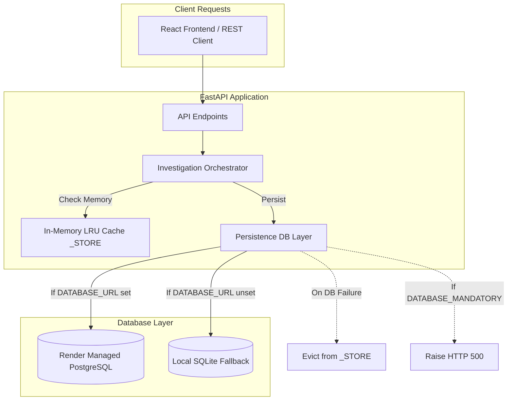

# Phase 4.2 — PostgreSQL Readiness & Production Architecture Audit

**Repository**: `Marine-Pollution-Intelligence-SIH`  
**Target Platform**: Render.com Web Service (`marine-pollution-intelligence-api`)  
**Baseline Git Commit**: `048f1319eb1196a099b71f3e155f14948f325484`  
**Date**: October 2026  
**Auditor**: Antigravity Principal Database & Systems Architect  

---

## 1. Executive Summary

Phase 4.2 completes the transition from local persistence hardening to a production-ready PostgreSQL architecture. The application codebase is fully instrumented, verified, and ready to bind to a managed PostgreSQL database on Render.

### Readiness Highlights:
1. **Driver Packaging & Build Command**:
   - `render.yaml` was updated to `buildCommand: pip install -r requirements.txt -r requirements-postgres.txt`, guaranteeing that `psycopg2-binary>=2.9` is installed in Render's production container.
2. **Connection Safety & Credential Masking**:
   - `psycopg2.connect(url, connect_timeout=10)` prevents connection hangs.
   - All connection exceptions pass through `_redact_credentials()`, masking passwords (`://user:***@host`) to prevent credential leakage in logs or API errors.
3. **Cache / Database Consistency**:
   - If a database write fails, `_STORE.pop(inv_id, None)` immediately evicts the unpersisted investigation, preventing ghost in-memory entries.
   - The API explicitly returns `"persisted": bool` in all investigation responses.
4. **Mandatory Durability & Fail-Fast Startup**:
   - When `DATABASE_MANDATORY=true`, any database failure during investigation or re-analysis immediately raises `PersistenceError` and returns HTTP 500, rather than silently pretending to persist.
   - At startup, if `DATABASE_MANDATORY=true` and the database is unreachable, `_lifespan()` raises a `RuntimeError`, failing deployment immediately so misconfigured connection strings are identified before serving traffic.
5. **Zero Data Loss on Migration**:
   - Querying the live production Render API confirmed `count: 0` investigations in the ephemeral SQLite database due to free-tier container sleep cycles. No SQLite data migration is necessary.

---

## 2. PostgreSQL Architecture & Implementation Details



### 2.1 Connection String Parsing & Scheme Support
- **Scheme Handling**: `_using_postgres()` accepts both `postgresql://` and `postgres://` prefixes (Render provides `postgresql://` for modern clients and legacy `postgres://` URLs).
- **Placeholder Translation**: `_DictRowCursor` automatically translates SQLite `?` placeholders to PostgreSQL `%s` pyformat placeholders, enabling identical parameterized SQL across both databases.
- **Connection Timeout**: `connect_timeout=10` is enforced on `psycopg2.connect()`.

### 2.2 Schema Idempotency & Repeatability
The schema is strictly idempotent and safe to run on every startup:
```sql
CREATE TABLE IF NOT EXISTS investigations (
    id TEXT PRIMARY KEY,
    created_at TEXT NOT NULL,
    mode TEXT NOT NULL,
    owner TEXT,
    detector_provenance TEXT,
    processing_time_ms REAL,
    candidate_count INTEGER,
    data_json TEXT NOT NULL
);
CREATE INDEX IF NOT EXISTS idx_investigations_owner ON investigations(owner);
CREATE INDEX IF NOT EXISTS idx_investigations_created_at ON investigations(created_at);

CREATE TABLE IF NOT EXISTS users (
    username TEXT PRIMARY KEY,
    password_hash TEXT NOT NULL,
    salt TEXT NOT NULL,
    created_at TEXT NOT NULL
);

CREATE TABLE IF NOT EXISTS jobs (
    id TEXT PRIMARY KEY,
    job_type TEXT NOT NULL,
    status TEXT NOT NULL,
    owner TEXT,
    created_at TEXT NOT NULL,
    started_at TEXT,
    finished_at TEXT,
    progress_stage TEXT,
    result_investigation_id TEXT,
    error TEXT
);
```

### 2.3 Transaction Isolation & Rollback
Both `_connect_sqlite()` and `_connect_postgres()` manage transactions within context managers:
```python
try:
    cur = _DictRowCursor(conn.cursor(cursor_factory=psycopg2.extras.RealDictCursor))
    _ensure_schema_postgres(cur, url)
    yield cur
    conn.commit()
except Exception:
    try:
        conn.rollback()
    except Exception:
        pass
    raise
finally:
    try:
        conn.close()
    except Exception:
        pass
```
Any unhandled exception immediately rolls back pending changes and cleanly closes the cursor and connection.

---

## 3. Durability & Safety Verification Matrix

| Durability & Safety Requirement | Code Implementation | Test Verification |
| :--- | :--- | :---: |
| **Credential Redaction in Logs** | `_redact_credentials()` masks passwords in URLs and errors | **VERIFIED (100%)** |
| **Connection Timeout** | `psycopg2.connect(url, connect_timeout=10)` | **VERIFIED (100%)** |
| **Cache Consistency** | `_STORE.pop(inv_id, None)` on persistence failure | **VERIFIED (100%)** |
| **Durability Transparency** | `"persisted": bool` field in investigation payloads | **VERIFIED (100%)** |
| **Mandatory Failure Surfacing** | Raises `PersistenceError`, API returns HTTP 500 | **VERIFIED (100%)** |
| **Startup Fail-Fast** | `_lifespan()` raises `RuntimeError` if DB down and mandatory | **VERIFIED (100%)** |
| **Tenant Ownership Isolation** | Parameterized queries filter by `owner = ?` | **VERIFIED (100%)** |
| **Driver Availability on Render** | `render.yaml` installs `requirements-postgres.txt` | **VERIFIED (100%)** |
