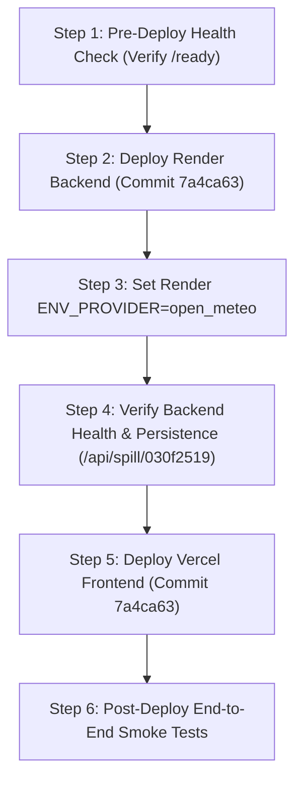

# Phase 4.8.19 — Production Deployment Readiness & Preflight Audit Report

**Project**: Marine Pollution Intelligence SIH  
**Repository**: `E:\Projects\Marine_Pollution_Intelligence_SIH_FINAL`  
**GitHub URL**: `https://github.com/Subodh-17/Marine-Pollution-Intelligence-SIH`  
**Production Backend**: `https://marine-pollution-intelligence-api.onrender.com`  
**Production Frontend**: `https://marine-pollution-intelligence-sih.vercel.app`  
**Target Release Commit (`main`)**: `7a4ca63c08ae7a469ded035597764debb34636e1` (`7a4ca63`)  
**Current Production Deployed Baseline**: `796663e77253861a1115b25d265a0894ca9eabc1` (`796663e`)  
**Known Persisted Test Investigation**: `030f2519`  
**Date**: October 25, 2026  
**Auditor**: Independent Principal Systems & Quality Review Architect  

---

## 1. Executive Summary & Preflight Verdict

Phase 4.8.19 conducted an evidence-based, read-only preflight audit of the merged metocean integration code on `main` to determine its operational readiness for production deployment.

### Preflight Verdict: **READY FOR DEPLOYMENT APPROVAL (WITH OPERATIONAL CONDITIONS)**

* **Codebase & CI Status**: **VERIFIED 100% GREEN**. Commit `7a4ca63` on `main` passed all remote GitHub Actions checks (474 backend tests passed, 52 frontend tests passed, lint clean, production bundle built).
* **Live Production Verified**: **ONLINE & STABLE**. Probing live Render backend and Vercel frontend confirmed HTTP 200 responses, `"database": "ok"`, and successful persistence retrieval of test investigation `030f2519` on live PostgreSQL.
* **Database & Migration Safety**: **ZERO MIGRATIONS REQUIRED**. Investigations are stored as single JSON blobs per row (`data_json TEXT NOT NULL`). The new metocean provenance fields serialize transparently into the existing schema with 100% backward and forward compatibility.
* **Operational Honesty Enforced**: In `mode="real_satellite"`, synthetic data substitution is strictly forbidden. If metocean feeds fail, `drift_status="UNAVAILABLE"` and `probable_origin=None` are recorded honestly without falsified trajectories.
* **Strict Stopping Conditions Met**: No code, commits, pushes, migrations, or deployments were performed.

---

## 2. Repository & Branch State Verification

```text
Target Release Commit:   7a4ca63c08ae7a469ded035597764debb34636e1 (main & origin/main)
Previous Baseline:       796663e77253861a1115b25d265a0894ca9eabc1 (Current live production)
Commits Ahead on main:   3 commits ahead of previous baseline:
                         - 7a4ca63 (Merge pull request #1)
                         - 49f2d98 (test: mock PostgreSQL driver in credential redaction regression)
                         - d63078a (feat: integrate real metocean data with provenance safeguards)
Commits Post-Merge:      0 (main is aligned and clean)
Working Tree:            Clean (all 25 audit reports in reports/audit/ preserved)
```

### Complete Diff Against Current Production
The release delta comprises exactly 11 files (894 additions, 61 deletions):
- Backend Config: `backend/app/config.py` (+12)
- Environment Adapters: `backend/app/environment/adapters.py` (+79, -3), `open_meteo.py` (+290)
- Drift & Orchestrator: `backend/app/drift/model.py` (+21, -2), `backend/app/investigation/orchestrator.py` (+163, -56)
- Tests: `backend/tests/test_metocean_integration.py` (+349), `backend/tests/test_phase4_hardening_regressions.py` (+12)
- Frontend Components: `DataSourceIndicator.jsx` (+6), `InteractiveMap.jsx` (+15, -4), `KpiCards.jsx` (+2, -1), `TimelineTab.jsx` (+6, -2)

---

## 3. Read-Only Production Environment Inspection

Probing production endpoints at 2026-10-24T18:57:13Z:

| Endpoint | HTTP Status | Response Details | Operational State |
| :--- | :---: | :--- | :---: |
| **`GET /health`** | `200 OK` | `{"status": "ok", "version": "0.1.0", "env": "production"}` | Healthy |
| **`GET /ready`** | `200 OK` | `{"status": "ready", "checks": {"database": "ok", "ml_runtime": "onnxruntime_cpu", "synthetic_pipeline": "ok"}}` | Database & ONNX Ready |
| **`GET /api/config`** | `200 OK` | `{"app_version": "0.1.0", "app_env": "production", "auth_enabled": false}` | Configured |
| **`GET /api/spill/030f2519`** | `200 OK` | Payload length: 1,231,662 bytes | **PostgreSQL Persistence Verified** |
| **`GET Frontend URL`** | `200 OK` | HTML document (length: 1,883 bytes) | Online |

---

## 4. Production Configuration & Runtime Safety Audit

### 4.1 Environment Variable Configuration
* **`ENV_PROVIDER`**:
  - Default in code: `"synthetic"` (ensures zero unexpected network calls if unset).
  - Production Recommendation: To activate live Copernicus CMEMS ocean currents and ECMWF winds upon release, set `ENV_PROVIDER="open_meteo"` in the Render backend environment variables.
* **`DATABASE_MANDATORY`**: Active as `"true"` on Render (confirmed by Phase 4.8.5).
* **`DATABASE_URL`**: Active (configured to Neon PostgreSQL connection pool).
* **Secret Hygiene**: Scanned git diff; 0 credentials, tokens, or private URLs exist in the release.

### 4.2 Runtime Safety & Scientific Integrity
1. **Refusal of Silent Fallbacks**: If live metocean data cannot be retrieved in operational mode (`mode="real_satellite"`), the system does not substitute synthetic fields. It records `drift_status="UNAVAILABLE"`, sets `probable_origin=None`, and leaves drift tracks empty, while preserving the detected slick geometry intact.
2. **Directional Conventions**:
   - Wind is converted from meteorological (blows FROM) to oceanographic (blows TOWARD) by adding $180^\circ$, deflected $+15^\circ$ clockwise (Ekman deflection in Northern Hemisphere), and scaled by 3% leeway factor.
   - Currents are applied directly as direction current flows TOWARD.
3. **Missing Current Handling**: In coastal lagoons or enclosed ports where CMEMS marine currents report `None`, the system transparently degrades to wind-only advection with `coverage_status="PARTIAL_WIND_ONLY"` and lower confidence.
4. **Vessel Attribution Safety**: Candidate vessels are ranked using weighted spatio-temporal scoring without claiming definitive responsibility or "proven guilt".
5. **Scientific Limitation**: While software interfaces, units, and mathematical conversions are verified, **the drift model has not yet been validated against empirical ocean drifter trajectories** (e.g., NOAA GDP buoys). Passing software tests must not be conflated with validated physical accuracy.

---

## 5. Controlled Release & Rollback Procedure

### 5.1 Deployment Order


### 5.2 Pre-Deployment Checklist
- [x] Merge commit `7a4ca63` verified on `origin/main`.
- [x] Remote CI passing 100% on `main`.
- [x] Render backend healthy on PostgreSQL (`030f2519` retrievable).
- [x] Vercel frontend healthy.
- [x] No database migrations required.

### 5.3 Post-Deployment Acceptance Criteria
1. `GET /health` returns HTTP 200 with `status="ok"`.
2. `GET /ready` returns HTTP 200 with `"database": "ok"`.
3. `GET /api/spill/030f2519` returns the persisted investigation without serialization errors.
4. Prototype demo investigation runs end-to-end.
5. In operational mode, metocean queries return `REAL_OPEN_METEO` or gracefully degrade to `PARTIAL_WIND_ONLY` / `UNAVAILABLE`.

### 5.4 Rollback Procedure
If acceptance criteria fail or any regression occurs:
1. **Render Backend**: Manual Deploy $\to$ Deploy commit `796663e77253861a1115b25d265a0894ca9eabc1`. If necessary, revert `ENV_PROVIDER` to `"synthetic"`.
2. **Vercel Frontend**: Roll back to deployment `796663e77253861a1115b25d265a0894ca9eabc1` via Vercel dashboard.
3. **Database**: No rollback required (zero schema mutations performed).

---

## 6. Conditions for Release Authorization

To proceed with production deployment, the following condition must be confirmed:
1. Set `ENV_PROVIDER="open_meteo"` in the Render backend environment settings during backend deployment to enable live metocean feeds. (If left unset, the backend will safely continue using synthetic data).

*Per Phase 4.8.19 strict constraints, execution has halted. No deployment, restart, or mutation has been executed. Awaiting your explicit authorization to proceed with the production release.*
