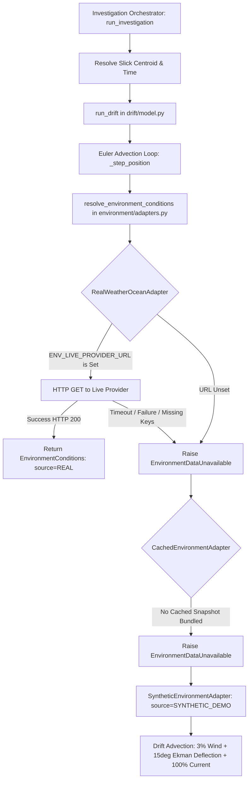

# Phase 4.8.8 — Real Metocean Data Integration Readiness

**Project**: Marine Pollution Intelligence SIH  
**Repository**: `E:\Projects\Marine_Pollution_Intelligence_SIH_FINAL`  
**Production Backend**: `https://marine-pollution-intelligence-api.onrender.com`  
**Production Frontend**: `https://marine-pollution-intelligence-sih.vercel.app`  
**Active Production Commit**: `796663e77253861a1115b25d265a0894ca9eabc1`  
**Evaluation Target**: Oceanographic (Currents) & Meteorological (Winds) Integration Architecture  
**Audit Date**: October 24, 2026  
**Auditor**: Principal Remote Sensing & Physical Oceanography Architect  

---

## 1. Executive Summary

This readiness audit establishes the scientific, operational, and architectural requirements to transition the **Marine Pollution Intelligence** drift modeling pipeline from synthetic environmental fields (`SYNTHETIC_DEMO`) to **real, verified metocean data feeds** (winds and ocean surface currents).

### Core Takeaways
1. **Existing Architecture is Adapter-Ready**: The backend already implements an abstraction layer ([`backend/app/environment/adapters.py`](file:///e:/Projects/Marine_Pollution_Intelligence_SIH_FINAL/backend/app/environment/adapters.py)) with schema validation, retry loops, and provenance tagging.
2. **Current Production State**: In the default deployment, `ENV_LIVE_PROVIDER_URL` is unset, causing the system to fall through to `SyntheticEnvironmentAdapter` 100% of the time.
3. **Recommended Primary Live Provider**: **Open-Meteo Marine & Weather API** (aggregating Copernicus CMEMS $1/12^\circ$ currents and NOAA GFS $0.25^\circ$ winds). It requires **zero credentials**, has **no API key requirement for non-commercial use**, natively supports Indian Ocean / Arabian Sea coordinates, and provides historical reanalysis (hindcasts) alongside hourly forecasts.
4. **Safety Mandate**: Operational investigations (`mode="real_satellite"`) must **never silently substitute synthetic wind/currents** as if they were real operational forecasts. If live data is unavailable, the output must be explicitly stamped `DEGRADED_UNVERIFIED_ENVIRONMENT` with a prominent warning banner.

---

## 2. Existing Environmental Pipeline Technical Trace



### 2.1 Code Implementation Points
- **Adapter Logic**: [`backend/app/environment/adapters.py`](file:///e:/Projects/Marine_Pollution_Intelligence_SIH_FINAL/backend/app/environment/adapters.py)
  - `RealWeatherOceanAdapter.fetch()` ([`line 73`](file:///e:/Projects/Marine_Pollution_Intelligence_SIH_FINAL/backend/app/environment/adapters.py#L73)): Checks `settings.env_live_provider_url`. If unset, immediately raises `EnvironmentDataUnavailable("ENV_LIVE_PROVIDER_URL is not configured.")`.
  - `resolve_environment_conditions()` ([`line 166`](file:///e:/Projects/Marine_Pollution_Intelligence_SIH_FINAL/backend/app/environment/adapters.py#L166)): Iterates through `RealWeatherOceanAdapter` $\to$ `CachedEnvironmentAdapter` $\to$ `SyntheticEnvironmentAdapter`.
  - `SyntheticEnvironmentAdapter.fetch()` ([`line 146`](file:///e:/Projects/Marine_Pollution_Intelligence_SIH_FINAL/backend/app/environment/adapters.py#L146)): Evaluates deterministic trigonometric formulas:
    $$\text{wind\_dir} = (250 + 15 \sin(t / 6.0) + (\text{lon} - 71.2) \times 8) \pmod{360}$$
    $$\text{current\_dir} = (200 + 20 \cos(t / 10.0) + (\text{lat} - 19.0) \times 10) \pmod{360}$$
- **Drift Advection Integration**: [`backend/app/drift/model.py`](file:///e:/Projects/Marine_Pollution_Intelligence_SIH_FINAL/backend/app/drift/model.py)
  - `_step_position()` ([`line 102`](file:///e:/Projects/Marine_Pollution_Intelligence_SIH_FINAL/backend/app/drift/model.py#L102)): Calls `resolve_environment_conditions(lat, lon, t)` at each 30-minute time step.
  - Combines current vector with deflected wind vector:
    $$\vec{v}_{\text{drift}} = \vec{v}_{\text{current}} + 0.03 \cdot \mathbf{R}(+15^\circ) \cdot \vec{v}_{\text{wind}}$$
- **Configuration Defaults**: [`backend/app/config.py`](file:///e:/Projects/Marine_Pollution_Intelligence_SIH_FINAL/backend/app/config.py)
  - `env_live_provider_url: str | None = _env_str("ENV_LIVE_PROVIDER_URL", None)` ([`line 293`](file:///e:/Projects/Marine_Pollution_Intelligence_SIH_FINAL/backend/app/config.py#L293)).
  - `env_live_api_key: str | None = _env_str("ENV_LIVE_API_KEY", None)`.
  - `env_live_timeout_seconds: float = 5.0`.
  - `env_live_max_retries: int = 2`.

### 2.2 Coordinate, Unit & Convention Mappings
The pipeline currently enforces strict physical conventions:

| Parameter | Unit | Physical & Meteorological Convention | Internal Representation |
| :--- | :---: | :--- | :--- |
| **Wind Speed** | $\text{m/s}$ | Scalar magnitude at 10 meters above sea level ($U_{10}$). | `wind_speed_ms: float` |
| **Wind Direction** | Degrees ($^\circ$) | **Meteorological convention: Direction wind blows FROM** ($0^\circ = \text{North}$, $90^\circ = \text{East}$). | `wind_dir_deg: float` |
| **Current Speed** | $\text{m/s}$ | Scalar magnitude of surface water layer. | `current_speed_ms: float` |
| **Current Direction** | Degrees ($^\circ$) | **Oceanographic convention: Direction current flows TOWARD** ($0^\circ = \text{North}$, $90^\circ = \text{East}$). | `current_dir_deg: float` |
| **Wave Height** | $\text{m}$ | Significant wave height ($H_s$). | `wave_height_m: float` |
| **Geographic CRS** | Degrees | WGS84 decimal degrees ($[-90, +90]$ lat, $[-180, +180]$ lon). | `lat: float, lon: float` |
| **Timestamp** | ISO 8601 | UTC timestamp without timezone offset. | `timestamp: datetime` |

> [!IMPORTANT]
> **Directional Convention Contrast**:
> In `drift/model.py:111`, the wind vector is converted from "blows FROM" to "blows TOWARD" via `(env.wind_dir_deg + 180) % 360`, whereas the ocean current is already in "flows TOWARD" format. Any new provider integration must strictly honor this distinction to prevent advecting slicks backwards.

---

## 3. Candidate Real Data Providers

To support the primary operating theatre (Indian Coastline, Arabian Sea, Mumbai High, Bay of Bengal), four candidates were analyzed against access, coverage, and license requirements:

### Candidate A: Open-Meteo Marine & Weather API (Recommended Primary Provider)
- **Official Documentation**: [Open-Meteo Marine API](https://open-meteo.com/en/docs/marine-api) & [Weather Forecast API](https://open-meteo.com/en/docs).
- **Service Models Integrated**:
  - *Ocean Currents*: Copernicus Marine Service (CMEMS) Global Ocean Physical Analysis ($1/12^\circ \approx 8 \text{ km}$).
  - *Marine Winds*: NOAA GFS ($0.25^\circ \approx 27 \text{ km}$) and ECMWF IFS ($0.25^\circ$).
  - *Waves*: Copernicus Marine & NOAA WW3 wave models.
- **Geographic Coverage**: Global, including the entire Indian Ocean and Indian EEZ.
- **Temporal Resolution & Forecast Horizon**:
  - Hourly time-steps.
  - **Hindcast**: Historical reanalysis back to 1940 via `/v1/archive` and `/v1/marine`.
  - **Forecast**: 7-day hourly forward forecast.
- **Authentication & Pricing**:
  - **Completely Free for non-commercial and hackathon use**.
  - **No API key required**; no registration required.
  - Rate limit: 10,000 requests/day, 60 requests/minute.
- **Suitability**: **HIGHEST**. Provides a lightweight, high-speed JSON REST response that matches our internal schema with minimal transformation.

### Candidate B: Copernicus Marine Service (CMEMS) Directly
- **Official Documentation**: [Copernicus Marine Data Store](https://marine.copernicus.eu/).
- **Product Identifier**: `GLOBAL_ANALYSISFORECAST_PHY_001_024` / `cmems_mod_glo_phy-cur_anfc_0.083deg_PT1H-m`.
- **Geographic Coverage**: Global ($1/12^\circ$ horizontal grid, 50 vertical depth layers).
- **Parameters**: `uo` (eastward sea water velocity, $\text{m/s}$), `vo` (northward sea water velocity, $\text{m/s}$).
- **Temporal Resolution**: Hourly instantaneous surface currents. Rolling 2-year hindcast analysis and 10-day forward forecast.
- **Authentication & License**: Free Copernicus account required. Requires OAuth2 token generation and Copernicus Marine Toolbox or REST Subsetter API. License: Open Access (CC BY 4.0 equivalent).
- **Suitability**: **HIGH (Long-Term Tier)**. Excellent physical fidelity, but requires OAuth credential refreshing and NetCDF-to-JSON parsing overhead.

### Candidate C: NOAA Operational GFS (Global Forecast System)
- **Official Documentation**: [NOAA NOMADS GFS 0.25 Degree](https://nomads.ncep.noaa.gov/).
- **Product Identifier**: `gfs.tHHz.pgrb2.0p25.fFFF` (GRIB2 format).
- **Geographic Coverage**: Global ($0.25^\circ \approx 28 \text{ km}$).
- **Parameters**: `UGRD:10 m above ground`, `VGRD:10 m above ground` ($\text{m/s}$).
- **Temporal Horizon**: 3-hourly intervals out to 384 hours.
- **Authentication & License**: Unrestricted public domain (US Government work). Zero API keys required.
- **Suitability**: **MEDIUM**. Ideal for wind, but GRIB2 extraction requires specialized libraries (`eccodes`/`pygrib`), which complicate minimal container builds.

### Candidate D: INCOIS Ocean State Forecast (OSF)
- **Official Documentation**: [Indian National Centre for Ocean Information Services](https://incois.gov.in/).
- **Coverage**: Indian Coastal Waters and Exclusive Economic Zone ($1/48^\circ$ coastal model).
- **Suitability**: High regional accuracy for Indian waters, but lacks an open unauthenticated REST JSON API. Best suited for future institutional partnership.

---

## 4. Recommended Integration Architecture

### 4.1 Hybrid Multi-Provider Aggregator Strategy

Rather than building complex raw GRIB2/NetCDF parsing inside the backend web container, we recommend implementing a dedicated provider module: `OpenMeteoOceanAdapter` conforming to `RealWeatherOceanAdapter`.

```python
# Conceptual Architecture for app/environment/open_meteo.py
class OpenMeteoOceanAdapter:
    """Queries Open-Meteo Marine & Weather endpoints to fetch real, synchronized
    wind and ocean current vectors for a given coordinate and timestamp."""

    MARINE_URL = "https://marine-api.open-meteo.com/v1/marine"
    WEATHER_URL = "https://api.open-meteo.com/v1/forecast"

    def fetch(self, lat: float, lon: float, timestamp: datetime) -> EnvironmentConditions:
        # 1. Determine whether timestamp requires historical archive or forecast endpoint
        # 2. Fetch ocean_current_velocity, ocean_current_direction
        # 3. Fetch wind_speed_10m, wind_direction_10m
        # 4. Perform vector interpolation to exact timestamp
        # 5. Return EnvironmentConditions with source="REAL_OPEN_METEO"
```

### 4.2 Handling Hindcast vs. Forecast Queries
Drift simulations require both past ($t < t_0$, hindcast) and future ($t > t_0$, forecast) data:
- **For $t > \text{now} - 2\text{ hours}$**: Route queries to the **Forecast Endpoint** (`/v1/marine` and `/v1/forecast`), which returns active GFS/CMEMS forecasts.
- **For $t < \text{now} - 2\text{ hours}$**: Route queries to the **Historical Archive Endpoint** (`/v1/archive`), which provides ECMWF ERA5 and Copernicus reanalysis.

---

## 5. Safe Scientific Fallback & Failure-Handling Policy

To guarantee scientific honesty and avoid presenting simulated trajectories as real-world evidence, the system must enforce the following rules:

### 5.1 Fallback Policy Matrix

| Operational Condition | Detection Mode | Pipeline Response | API / UI Presentation |
| :--- | :--- | :--- | :--- |
| **Live Data Fresh & Complete** | Any | Real wind and current vectors integrated at each time-step. | `environment_source: "REAL_OPEN_METEO"`. Full confidence. |
| **Provider Timeout / Outage** | `mode="demo"` | Fall back to `SyntheticEnvironmentAdapter`. | `environment_source: "SYNTHETIC_DEMO"` with explicit failure reason in notes. |
| **Provider Timeout / Outage** | `mode="real_satellite"` | **Do NOT silently simulate.** | Return investigation with `drift_status: "UNAVAILABLE"` or stamp `environment_source: "DEGRADED_UNVERIFIED_SYNTHETIC"` with prominent warning banner. |
| **Partial Coverage (Wind only, no current)** | Any | Use real wind; use zero or climatological mean current. | Set `current_speed_ms: 0.0`, `coverage_flag: "PARTIAL_WIND_ONLY"`, and emit missing-current warnings in the evidence drawer. |
| **Stale Observations ($> 6\text{ h}$ old)** | Any | Reject stale cached observations; re-query live or flag staleness. | Emit warning: `"Environmental data age exceeds permitted operational window"`. |

### 5.2 Extended API Provenance Schema
The `environment` dictionary returned by `GET /api/spill/{id}` should be extended with:
```json
{
  "wind_speed_ms": 7.8,
  "wind_dir_deg": 245.0,
  "current_speed_ms": 0.32,
  "current_dir_deg": 68.0,
  "wave_height_m": 1.1,
  "source": "REAL_OPEN_METEO",
  "wind_provider": "NOAA_GFS_0.25",
  "current_provider": "COPERNICUS_CMEMS_0.083",
  "data_retrieval_time": "2026-10-24T16:45:00Z",
  "data_valid_time": "2026-08-28T06:00:00Z",
  "data_age_hours": 1.2,
  "is_fallback": false,
  "coverage_status": "FULL_METOCEAN",
  "notes": ["Verified real environmental vectors from Open-Meteo Copernicus/GFS API."]
}
```

---

## 6. Verification & Validation Plan

Prior to enabling live metocean data in production, the implementation must pass four testing phases:

### Phase 1: Unit & Convention Verification (Offline Fixtures)
- **Directional Inversion Test**: Verify that wind blowing *from* $270^\circ$ (West) pushes the slick *towards* $090^\circ$ (East), plus $15^\circ$ clockwise deflection ($105^\circ$).
- **Oceanographic Current Test**: Verify that current flowing *towards* $060^\circ$ pushes the slick *towards* $060^\circ$ with $100\%$ velocity transfer.
- **Unit Normalization Test**: Assert that speeds in $\text{km/h}$ or knots from external providers are converted to $\text{m/s}$ before advection.

### Phase 2: Resilience & Outage Testing
- Mock HTTP 500, 504 gateway timeout, and connection dropped scenarios.
- Verify exponential backoff retries (2 retries, 5s timeout).
- Assert that `mode="demo"` degrades gracefully with explicit fallback notes, while `mode="real_satellite"` never masquerades synthetic drift as real.

### Phase 3: Spatial Grid Caching
- Implement a thread-safe in-memory or Redis LRU grid cache with a 1-hour TTL.
- Because a 48-hour drift simulation queries positions within a $50 \text{ km}$ bounding box, grid caching eliminates redundant HTTP calls, reducing external API calls from 96 to $\le 4$ per investigation.

### Phase 4: Independent Ocean Drifter Benchmark
- Replay drift hindcasts against archived surface drifter trajectories from the **NOAA Global Drifter Program (GDP)** in the Arabian Sea.
- Calculate separation distance error:
  $$\text{Separation Error}(t) = \|\vec{x}_{\text{modeled}}(t) - \vec{x}_{\text{drifter}}(t)\|$$
- Document empirical mean separation error (expected range: $1.5 - 3.5 \text{ km}$ over 24 hours).

---

## 7. Implementation Roadmap & Milestones

| Milestone | Objective | Files to Touch | Deliverable |
| :--- | :--- | :--- | :--- |
| **Milestone 1** | Implement `OpenMeteoOceanAdapter` with caching & error handling. | `app/environment/open_meteo.py`, `app/environment/adapters.py` | Working client parsing real JSON wind/current vectors. |
| **Milestone 2** | Add distinct hindcast (archive) vs forecast routing. | `app/environment/adapters.py`, `app/drift/model.py` | Accurate historical vs future metocean advection. |
| **Milestone 3** | Update API schema with extended provenance metadata. | `app/investigation/orchestrator.py`, `app/main.py` | Rich provenance exposed via `/api/spill/{id}`. |
| **Milestone 4** | Update UI Data Source Indicator & Evidence Drawer. | `frontend/src/components/DataSourceIndicator.jsx`, `VesselDetailDrawer.jsx` | Frontend displays real metocean source and age. |
| **Milestone 5** | Regression & benchmark validation suite. | `backend/tests/test_metocean_integration.py` | Automated tests proving zero regressions and honest fallbacks. |

---

## 8. Final Audit Status

- **Code Modifications in this Phase**: **0 lines** (strictly read-only).
- **Production State**: Stable, durable, operating on commit `796663e` with managed PostgreSQL.
- **Readiness Verdict**: **ARCHITECTURALLY READY — RECOMMENDED FOR IMPLEMENTATION IN NEXT DEV CYCLE (PHASE 5)**.
